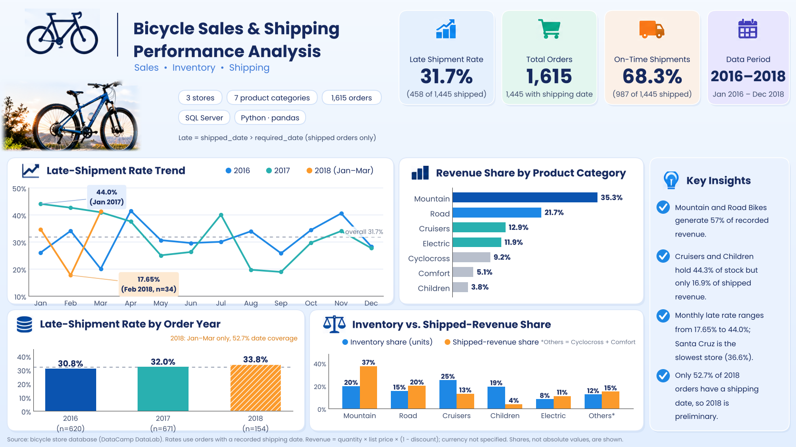
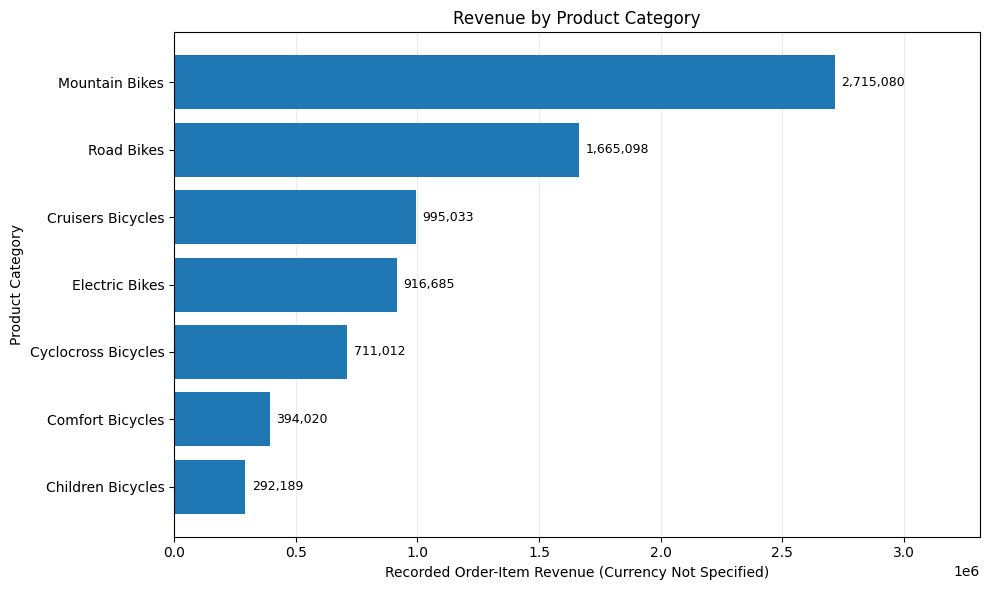
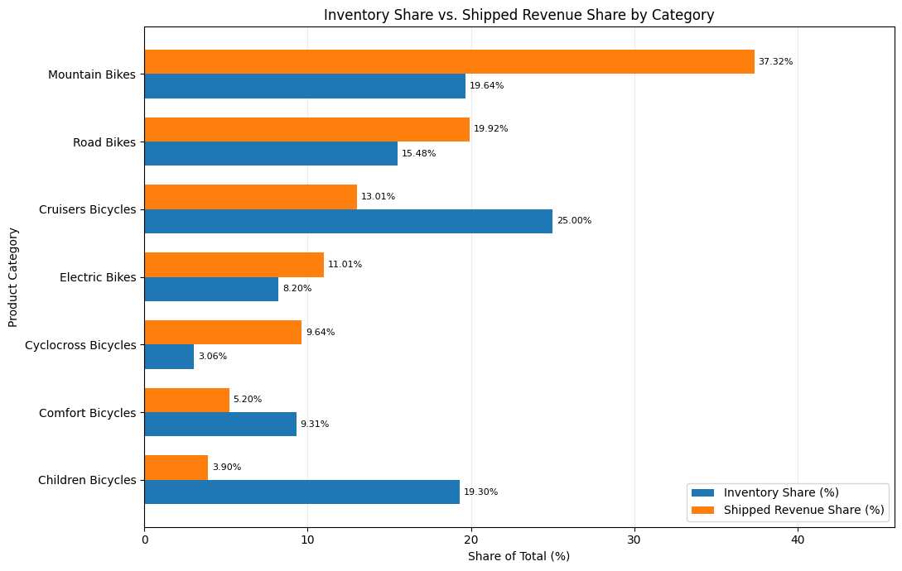
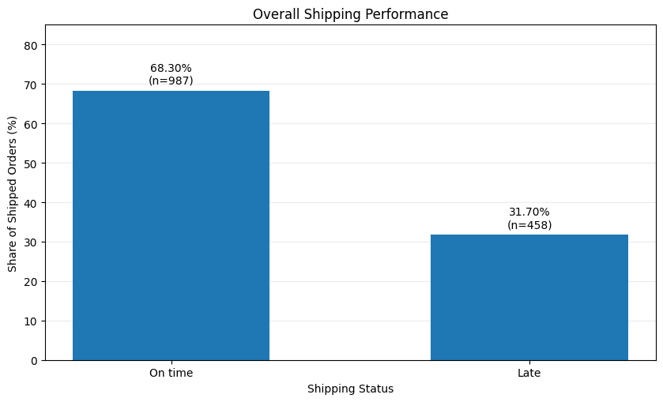
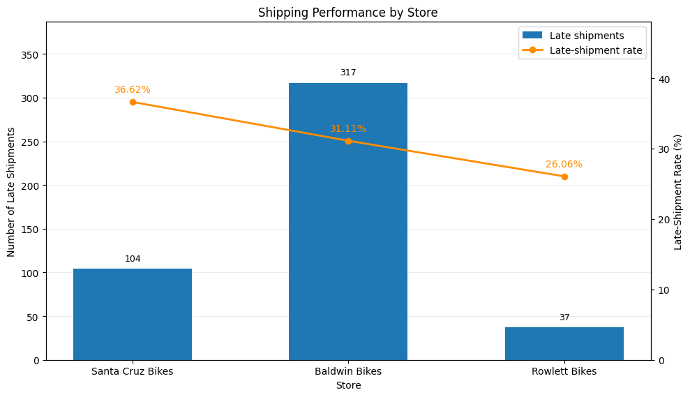
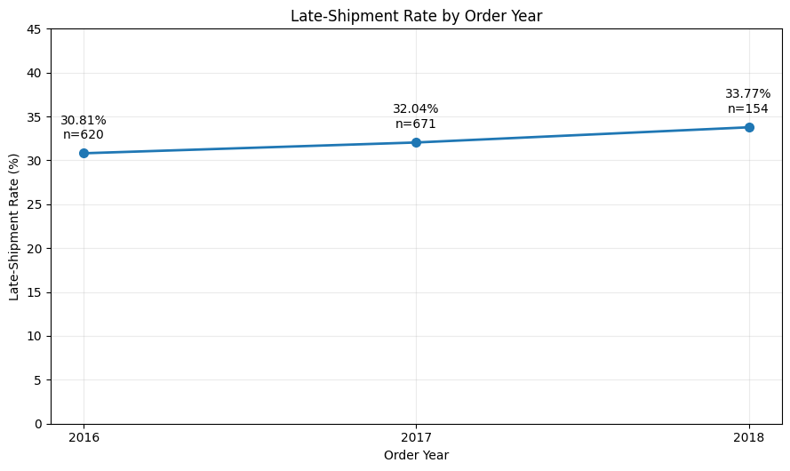
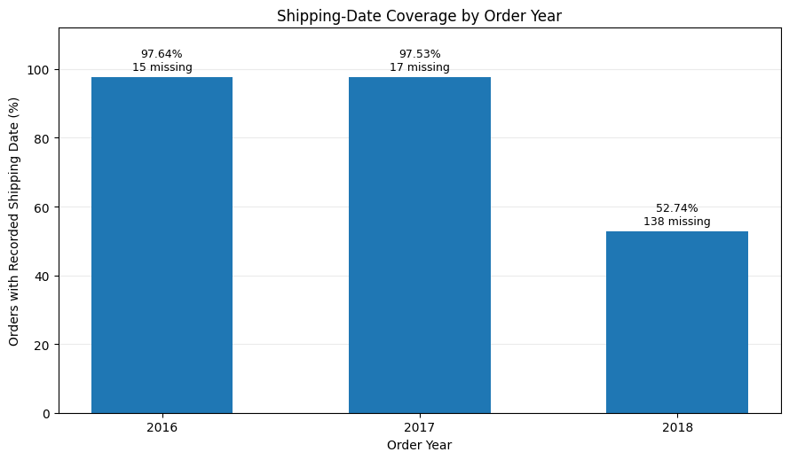
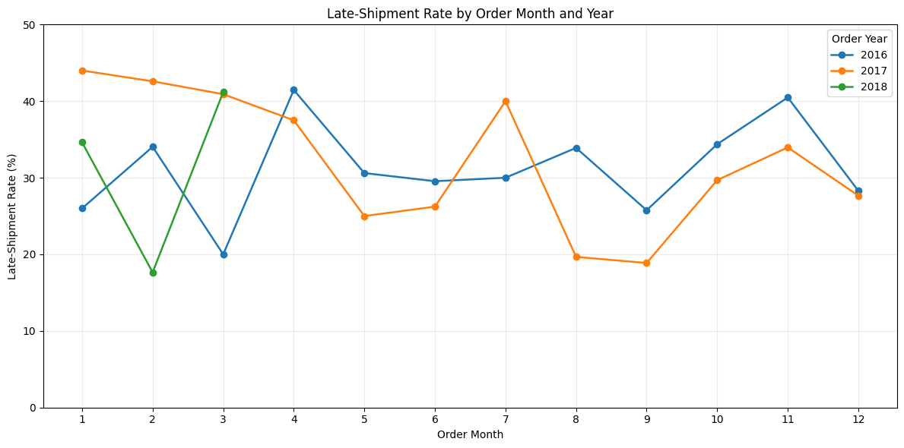

# Bicycle Sales & Shipping Performance Analysis

A SQL and Python portfolio project exploring bicycle retail sales, category-level inventory, and shipping timeliness using the BikeStores-style relational schema available in DataCamp DataLab.

## Project objectives

- Identify the categories and products contributing most to recorded order-item revenue.
- Compare category-level inventory share with revenue share from orders with a recorded shipping date.
- Measure the share of shipped orders shipped after their required date.
- Compare shipping performance by store and over order year/month.
- Assess how missing shipping dates affect interpretation.

## Tools

- **SQL Server / T-SQL** for joins, aggregation, ranking, and KPI calculation.
- **Python** with pandas and Matplotlib for tables and visualizations.
- **Jupyter Notebook** for presenting results and analytical reasoning.

## Repository structure

```text
.
├── README.md
├── requirements.txt
├── notebooks/
│   └── bicycle_sales_shipping_analysis.ipynb
├── sql/
│   ├── 01_data_quality.sql
│   ├── 02_sales_performance.sql
│   ├── 03_inventory_analysis.sql
│   ├── 04_shipping_performance.sql
│   └── README.md
├── data/
│   └── processed/       # Aggregate query results only; no customer-level data
└── images/              # Exported charts used in the notebook and this README
```

## Key findings



- **Revenue concentration:** Mountain Bikes generated 35.31% of recorded order-item revenue and Road Bikes 21.66%; together they contributed **56.97%**.
- **Inventory comparison:** Mountain Bikes and Road Bikes accounted for **57.24%** of shipped revenue versus **35.12%** of recorded inventory. Cruisers Bicycles and Children Bicycles accounted for **44.30%** of inventory and **16.91%** of shipped revenue. The stock snapshot date is unknown, so these are investigation signals, not proof of overstock or understock.
- **Shipping performance:** **458 of 1,445 shipped orders (31.70%)** were shipped after the required date.
- **Store comparison:** Santa Cruz Bikes had the highest late-shipment rate (**36.62%**); Baldwin Bikes had the highest count of late shipments (**317**) and shipment volume (**1,019**).
- **Data completeness:** Shipping-date coverage was **97.64%** in 2016, **97.53%** in 2017, and **52.74%** in 2018. Interpret the 2018 annual rate cautiously.
- **Top-product validation:** All ten products in the original top-10 ranking remained in the top ten after restricting the calculation to orders with a recorded shipping date, although some ranks changed.

## Selected visualizations

### Revenue by product category



### Inventory share versus shipped-revenue share



### Overall shipping performance



### Shipping performance by store



### Annual late-shipment rate and shipping-date coverage





### Monthly late-shipment rate



## Metric definitions and limitations

- **Late shipment:** `shipped_date > required_date`.
- **Late-shipment rate:** late shipments divided by orders with a non-null `shipped_date`.
- **Revenue:** `quantity × list_price × (1 − discount)`, shown in the dataset's monetary units because currency is not identified.
- **Order-year/month grouping:** Shipping rates over time are grouped by `order_date` year and month, not by shipment date.
- A late shipment is not necessarily a late customer delivery; no actual delivery date is available.
- Orders without a recorded shipping date are excluded from late-shipment rates. This is particularly important for 2018.
- The inventory snapshot date is unknown; inventory comparisons do not prove overstocking or understocking.
- The analysis is descriptive. Additional operational data is needed to establish causes.

## Reproducing the notebook

1. Use Python 3.10+.
2. Install the requirements:

   ```bash
   pip install -r requirements.txt
   ```
3. Open `notebooks/bicycle_sales_shipping_analysis.ipynb` in Jupyter and run all cells. The notebook loads the aggregate CSVs in `data/processed/` and regenerates the tables and charts.
4. To recompute the SQL outputs from source, run the scripts in `sql/` against a compatible SQL Server BikeStores database with the `sales` and `production` schemas. The raw database is not included in this repository.

## Data privacy

This repository contains aggregate analysis outputs only. It does not include raw customer records, email addresses, or street addresses.

**Interactive DataLab Workbook:** [View the original project in DataCamp](https://www.datacamp.com/datalab/w/5182a650-f9b8-47da-8cf0-1176ae86a0a8)
